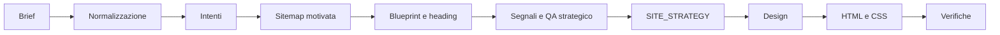

# SEO to Static Workflow

**Prima capire cosa deve dire il sito. Poi costruirlo.**

Progetto portfolio di **Flavio2702**: un workflow in italiano che accompagna un
assistente AI dal brief di un'attivita locale alla strategia SEO, al design e a un
sito statico. Sette passaggi strategici lasciano documenti verificabili; il sito
deve usare quelle decisioni, non ripartire da un prompt generico.

**[Apri il sito dimostrativo](https://flavio2702.github.io/seo-to-static-workflow/site/)**
oppure segui la **[demo dal brief al risultato](demo/README.md)**. Tutto consultabile
senza installazione, con dati inventati e senza moduli attivi.

## Il problema e le competenze mostrate

Generare subito una pagina puo nascondere domande irrisolte: quali servizi meritano
un URL, cosa deve fare il visitatore, quali affermazioni hanno una fonte e cosa
escludere. Qui queste scelte precedono la costruzione e restano consultabili.

- Analisi dei requisiti, intenti, architettura informativa e collegamenti interni.
- Progettazione di procedure AI con input, output, gate e passaggi di consegna.
- Separazione di strategia, contenuti, design e implementazione HTML/CSS.
- Isolamento dei progetti, configurazione locale e tracciabilita delle decisioni.
- Test riproducibili, verifiche desktop/mobile e preparazione di una distribuzione pubblica.

Il repository conserva il sistema, la knowledge base, il template completo e gli
strumenti riutilizzabili del progetto originale. La demo e un'aggiunta riproducibile,
non una sostituzione del workflow con un generatore ridotto.

## Guarda il passaggio SEO → sito



Nella demo, [strategy.json](demo/strategy.json) rende controllabile il passaggio:
URL, title, description, heading, contenuti e link vengono consumati dal renderer
e confrontati con l'HTML dai test. [Matrice delle decisioni](demo/TRACEABILITY.md).

## Avvio rapido

Per demo e controlli di base: **Python 3.11 o successivo**, senza pacchetti da installare.

```sh
git clone https://github.com/Flavio2702/seo-to-static-workflow.git
cd seo-to-static-workflow
python scripts/demo.py --check
python -m unittest discover -s tests -v
python -m http.server 8080 --bind 127.0.0.1 --directory demo/site
```

Apri **http://127.0.0.1:8080/**. Per rigenerare in una cartella ignorata:
`python scripts/demo.py`. Per iniziare un tuo progetto:
`python scripts/prepara.py il-mio-progetto`, poi compila
`projects/il-mio-progetto/01_INPUT/CLIENT_BRIEF.md` e segui [la guida](docs/GUIDA.md).
Il comando rifiuta di sovrascrivere un progetto esistente.

Per i controlli nel browser servono anche **Node.js 20+** e Chromium:

```sh
cd 04_TOOLS/design-qa-fast-lane
npm ci --ignore-scripts --no-audit --no-fund
npm run install:browsers
npm run self-test
```

Il primo download richiede rete. Test e demo non richiedono chiavi, modelli AI o
chiamate a pagamento. Su sistemi con `python3`, usalo al posto di `python`.

## Cosa fa davvero

| Parte | Implementazione |
| --- | --- |
| SEO e copy | Procedure eseguite dall'assistente; non una pipeline API autonoma |
| Design e sito reale | Lavoro assistito, con integrazione locale Impeccable opzionale da installare |
| Creazione cartella progetto | Script Python che copia il template completo |
| Riproduzione demo | Render deterministico degli elaborati sintetici congelati |
| Controlli strutturali | Python e Playwright; non misurano domanda di ricerca o qualita AI |
| Approvazioni e QA di consegna | Procedure manuali; la demo non certifica i gate commerciali |

La ricerca della demo e dichiaratamente sintetica: query ipotetiche, nessuna SERP
live, volume, ranking o risultato commerciale. Tutte le pagine sono `noindex`;
lo schema LocalBusiness e escluso perche l'attivita non esiste.

## Documentazione

- [Guida operativa](docs/GUIDA.md) e [architettura](docs/ARCHITETTURA.md)
- [Matrice capacita → implementazione → verifica](docs/COPERTURA.md)
- [Ambiente ed esiti effettivi](docs/VERIFICHE.md)
- [Privacy e servizi esterni](docs/PRIVACY.md), [limiti e parti incomplete](docs/LIMITI.md)
- [Inventario e provenienza](docs/PROVENIENZA.md), [attribuzioni](THIRD_PARTY_NOTICES.md)
- [GitHub Actions](https://github.com/Flavio2702/seo-to-static-workflow/actions)

Sviluppato e preparato con assistenza AI (OpenAI Codex). Il portfolio mostra artefatti
e verifiche, senza attribuire esperienze o risultati professionali non dimostrati.
[Apache License 2.0](LICENSE) per i contributi originali concedibili, copyright
2026 Flavio2702; [NOTICE](NOTICE). Nessuna promessa di posizionamento, citazioni AI,
sicurezza assoluta o idoneita alla produzione.
